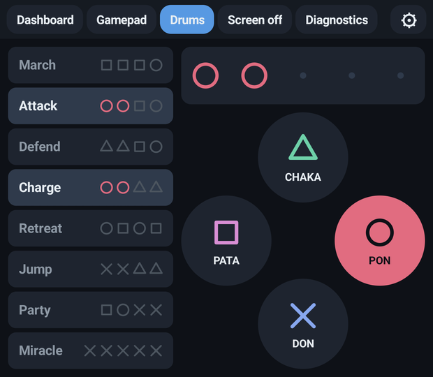
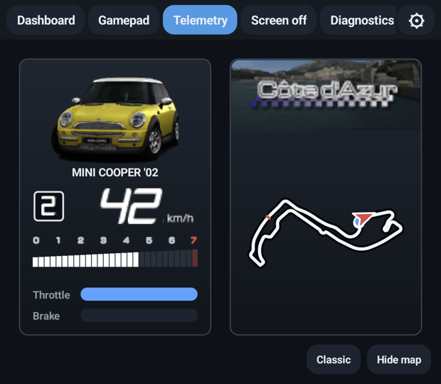
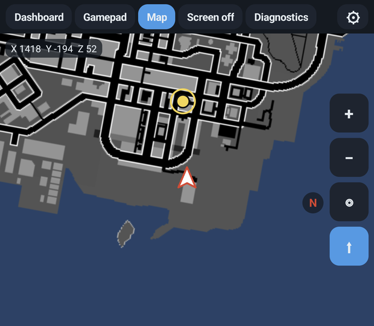
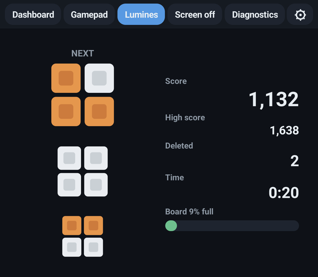

[English](README.md) | **台灣繁體中文**

<p align="center">
  
</p>

<h1 align="center">PPSSPP Duo</h1>

<p align="center">
  <b>PSP 模擬器 PPSSPP 的雙螢幕擴充版本，專為 AYN Thor 等雙螢幕 Android 掌機打造。</b><br>
  遊戲畫面留在主螢幕；第二螢幕則顯示專屬模組：快捷操作、虛擬手把或為您正在遊玩的遊戲量身打造的輔助面板。
</p>

<p align="center">
  <a href="https://github.com/mkaflowski/PPSSPP-Duo/releases"></a>
  <a href="https://github.com/mkaflowski/PPSSPP-Duo/releases/latest"></a>
  
  <a href="LICENSE.TXT"></a>
</p>

<p align="center">
  <a href="https://apps.obtainium.imranr.dev/redirect?r=obtainium://add/https://github.com/mkaflowski/PPSSPP-Duo"></a>
</p>

> **本專案不包含任何遊戲。** 本儲存庫與其發行版本僅包含模擬器本體。請使用您自行合法購買的遊戲（從個人 UMD 擷取或數位購買）。

## 基於 PPSSPP

PPSSPP Duo 是 [**PPSSPP**](https://github.com/hrydgard/ppsspp) 的分支，原版 PSP 模擬器由 Henrik Rydgård 與 PPSSPP 團隊開發（[ppsspp.org](https://www.ppsspp.org/)）。所有模擬核心皆來自原版，Duo 則加入了第二螢幕支援。它會作為獨立應用程式（`org.ppsspp.ppssppduo`）安裝，可與一般版 PPSSPP 並存。原版說明文件位於 [README-PPSSPP.md](README-PPSSPP.md)。

如果您喜歡這款模擬器，歡迎透過 [PPSSPP Gold](https://www.ppsspp.org/buygold) 支持原版專案。

## 支援雙螢幕模組的遊戲

啟動以下任一款遊戲時，其專屬模組會自動在第二螢幕開啟。

| 遊戲 | 模組 | 第二螢幕顯示內容 | 測試版本 |
|---|---|---|---|
| **Patapon** | 戰鼓 | 大型 PATA / PON / CHAKA / DON 戰鼓按鍵（提供遊戲原版鼓面美術或經典外觀），以及隨節奏亮起的戰歌譜（支援實體按鍵） | UCES00995 (EU) |
| **Patapon 2** | 戰鼓 | 相同的戰鼓按鍵與戰歌譜，收錄 Patapon 2 曲目 | UCES01177 v1.00 (EU) |
| **Grand Theft Auto: Liberty City Stories** | 地圖 | 完整城市地圖（由遊戲內建雷達建立）、玩家位置與朝向、行駛路線、任務目標與目的地、依面向自動旋轉 | ULES00151 v3.00 (EU) |
| **Lumines: Puzzle Fusion** | Lumines | 大型下個方塊預覽、分數、最高分、消除方塊數、時間與盤面填滿度 | ULES00043 v1.01 (EU) |
| **跑車浪漫旅（Gran Turismo）** | 遙測儀表 | 時速、含車輛紅線區的轉速表、檔位、遊戲原版 HUD 風格的油門與煞車、車輛圖片，以及含標誌與所有車輛位置的完整賽道地圖（或簡潔外觀） | UCES01245 v2.00 (EU) |
| **Metal Gear Ac!d** | 卡牌 | 依遊戲抽牌顯示清晰放大的手牌插圖與游標下卡片的完整說明；點擊卡片即可將遊戲游標移至該卡。另顯示 Snake 生命值、牌組、COST 與回合 | ULUS10006 v1.00 (US) |
| **聖女貞德（Jeanne d'Arc）** | 戰鬥 | 依遊戲狀態視窗風格、頭像與字體繪製我方隊伍與敵人的 HP、MP、等級與回合數（陣亡顯示黑白、訪客標記） | UCUS98700 v1.00 (US) |
| **WipEout Pure** | 競速 | 名次、圈數、含 HUD 速度條的時速、護盾能量、比賽與單圈時間（上一圈與最佳），以及依所有賽車行駛軌跡即時繪製的賽道地圖（全採用遊戲原版 HUD 字體） | UCUS98612 v2.00 (US) |
| **女神異聞錄 3 攜帶版（Persona 3 Portable）** | 敵情分析 | 戰鬥中顯示我方隊伍附 HUD 頭像的 HP 與 SP，以及所有敵人的等級、秘儀、HP 與屬性耐性（弱點、耐性、無效、反彈、吸收），採用遊戲分析畫面風格與屬性圖示 | ULES01523 v1.01 (EU) |
| **女神異聞錄（Persona）** | 隊伍 | 戰鬥中以《真・女神轉生 IV》風格顯示每位隊友與敵人卡片（含從光碟讀取的頭像、HP、SP 與等級）；迷宮中則顯示走過的樓層地圖（含牆壁與門），下方顯示我方 HP 與 SP | ULUS10432 v1.00 (US) |
| **遊戲王 GX Tag Force** | 決鬥 | 以遊戲原版卡框與高畫質卡圖完整顯示游標下的卡片、效果文字、ATK/DEF 面板、屬性與等級；同時顯示雙方生命值、目前回合歸屬與階段 | ULES00600 v1.01 (EU) |

其他版本也會被辨識，且模組在執行時會動態搜尋遊戲資料而非依賴固定記憶體位址，但僅上述版本經過完整測試。例外情況：《聖女貞德》、《Metal Gear Ac!d》與《WipEout Pure》的模組目前僅支援美版（US）；《女神異聞錄 3 攜帶版》僅支援歐版（美版可辨識但未測試）；《遊戲王 GX Tag Force》僅支援歐版；《女神異聞錄》僅支援美版。

<p align="center">
  
  
  
  
</p>

## 通用於所有遊戲的模組

- **儀表板（Dashboard）**：遊戲圖示與名稱、FPS 與速度、時鐘與電量、附欄位選擇器的即時存檔／讀檔、快轉、切換速度、倒轉、選單、暫停、螢幕擷取、靜音。
- **手把（Gamepad）**：包含所有 PSP 按鍵與類比搖桿，支援多點觸控。
- **關閉螢幕（Screen off）**：隱藏分頁列的純黑畫面，用來節省電力。
- **診斷（Diagnostics）**：模擬器狀態、顯示器資訊與記憶體檢視（供模組開發者使用）。

透過第二螢幕頂部的分頁列切換模組，每個遊戲的選擇都會分別記住。齒輪分頁提供設定（預設模組、觸覺回饋、顯示器選擇）。在主螢幕位於下方的裝置（如 Anbernic RG DS）上，可在該頁面開啟**互換螢幕**將遊戲移至上方螢幕。

## 安裝方式

1. 從 [Releases](https://github.com/mkaflowski/PPSSPP-Duo/releases) 下載 APK，或將 `https://github.com/mkaflowski/PPSSPP-Duo` 加入 [Obtainium](https://github.com/ImranR98/Obtainium)（點擊上方徽章即可一鍵加入）以自動接收更新。
2. 安裝 APK，不會覆蓋原本的一般版 PPSSPP。
3. 啟動遊戲。在雙螢幕裝置上第二螢幕會自動開啟；在單螢幕手機上則與一般版 PPSSPP 相同。

可在 **設定 → 系統 → 使用第二螢幕** 或第二螢幕設定頁底部的按鈕關閉第二螢幕。

## 自行建置

```
gradlew :android:assembleDuoOptimized
```

實際遊玩請使用 `duoOptimized`（或 `duoRelease`）建置變體。`duoDebug` 未啟用最佳化，執行 GTA 等高負載遊戲時速度約只有一半。

## 撰寫模組

每個模組都是一個獨立的 Java 類別：為第二螢幕建立 Android 視圖，並透過精簡 API 讀取模擬器狀態（按鍵、虛擬按鍵、遊戲狀態、記憶體監看、特徵碼掃描、從遊戲光碟讀取檔案）。詳見 [docs/ppsspp-duo.md](docs/ppsspp-duo.md)。

## 授權條款

與 PPSSPP 相同，採用 GPL v2 或更新版本授權。詳見 [LICENSE.TXT](LICENSE.TXT)。
